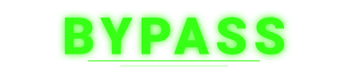
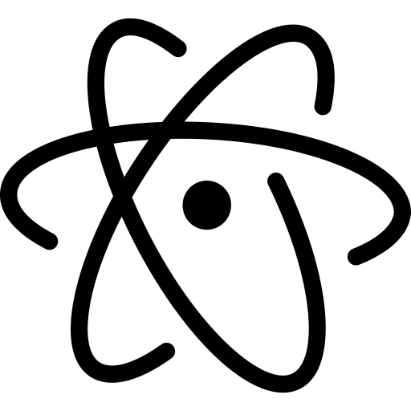
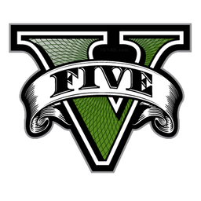
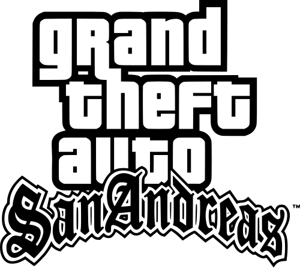
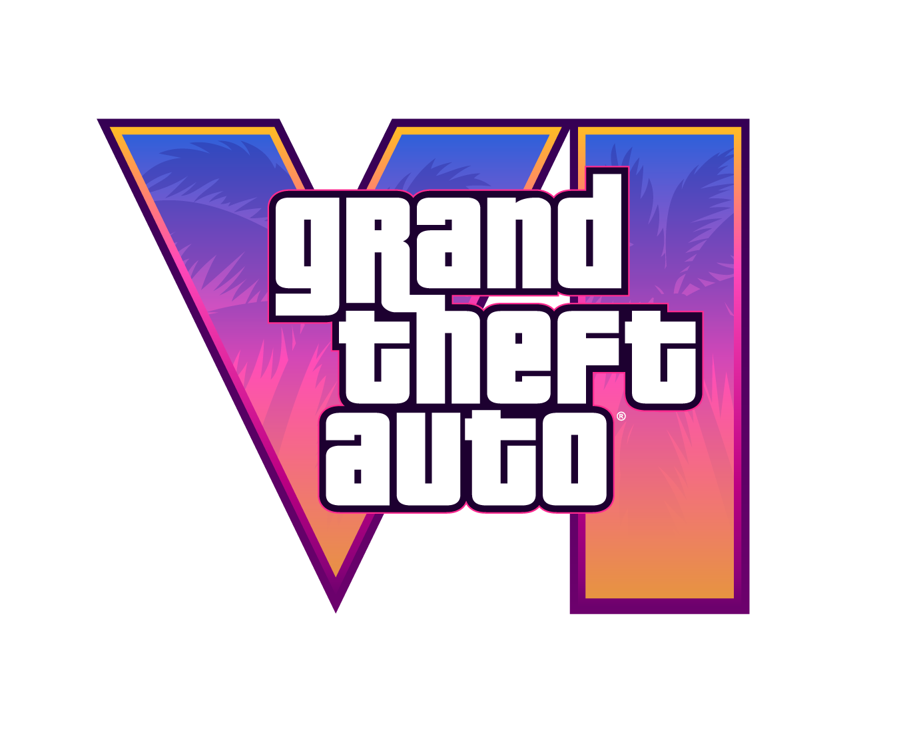

`ANDY-GGGG / README.md`

 

<!-- NOME ESTÁTICO -->

 

### Programador C++ | Engenheiro Reverso | Editor | Modelador 3D

 

**Diga não ao Python.**

 

<!-- TERMINAL ORIGINAL -->

  

<!-- SKILLS -->
   
 
   
 
   

  

---

###  Dashboard de Projetos

<table width="100%">
  <tr>
    <td width="50%" valign="top">
      <h4>
        
        
        
        LUAR RP
      </h4>
      
      
      
Roleplay em <b>múltiplos jogos e plataformas</b>, com multiplayer e progressão cruzada.

      <a href="https://site-jvyfnn288-andys-projects-9e308140.vercel.app/">Visualizar Site →</a>
      

        
<b>📖 Ler mais</b>

        
O <b>LUAR RP</b> é um ecossistema multiplayer em desenvolvimento para PC e dispositivos móveis. A proposta é integrar GTA V, GTA San Andreas e GTA VI, conectando jogadores e permitindo progressão compartilhada entre jogos e plataformas.

        
O desenvolvimento envolve o porte nativo do <b>GTA V para Android</b>, a reimplementação da engine do <b>GTA San Andreas em C++</b>, melhorias em RenderWare, draw calls, streaming e renderização, além da adaptação do mapa de GTA V ao GTA SA.

        
O suporte ao <b>GTA VI</b> e a integração da progressão entre jogos fazem parte do planejamento do ecossistema.

      

    </td>
    <td width="50%" valign="top">
      <h4>📂 Próximo Projeto</h4>
      
<i>Aguardando novas iniciativas de engenharia reversa ou desenvolvimento C++...</i>

      

        
<b>📖 Ler mais</b>

        
Espaço reservado para futuras pesquisas e projetos independentes de engenharia reversa e desenvolvimento de baixo nível.

      

    </td>
  </tr>
</table>

---

 

<!-- CONTADOR DE VISITAS MOE COUNTER -->

